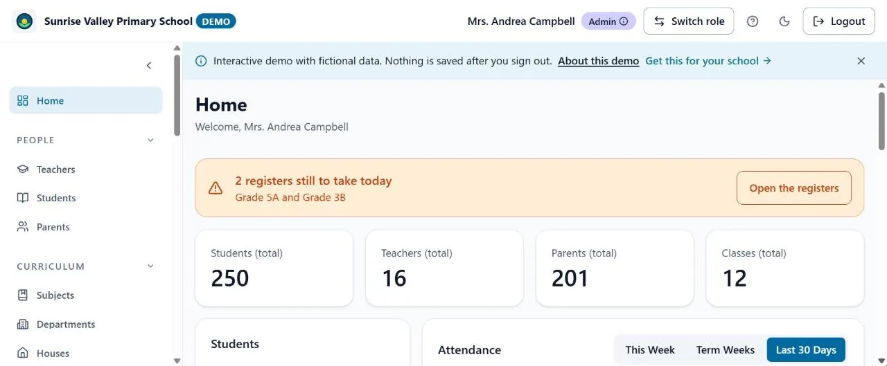

# School Management System: Showcase

**Live demo:** [sms-demo.solutions.genr83d.com](https://sms-demo.solutions.genr83d.com/). Sign in as any role with one click. Every school, name and number in the demo is fictional.

> The production source code is private and owned by [GENR8-3D](https://solutions.genr83d.com/). This repository is a showcase, shared with GENR8-3D's permission. It contains no source code.

## The problem

A school kept attendance on paper registers and grades in spreadsheets, and teachers had no single place to share assignments, lesson notes and timetables. GENR8-3D had an early prototype built on mock data that couldn't hold real records.

## My role

**Lead Product Engineer, GENR8-3D (May 2026 to present).** I led technical direction alongside two developers, then became the sole engineering owner. I own architecture, work scoping, code review and the release process.

## Architecture

- **Multi-tenancy:** all data is structured per institution and isolated across 7 user roles.
- **Security:** about 2,650 lines of Firestore security rules with automated rule tests, one active session per account, institution-gated sign-in, and file access limited by class and child.
- **Performance:** lazy-loaded routes and TanStack Query caching to cut load size and database reads.
- **Delivery:** a spec before most major features, semantic versioning, a changelog, and GitHub Actions release and PR checks.

## Results (as of November 2026)

| | |
| --- | --- |
| Pilot | 1 school off paper registers and grade spreadsheets |
| Features | 49 feature PRs in under 6 months: attendance registers, gradebook, PDF report cards, online exams, spreadsheet import |
| Performance | Entry bundle 3.88 MB to 0.46 MB (88% smaller); first-load JavaScript 4.53 MB to 1.12 MB (75% smaller) |
| Testing | 3 to 345 test files in about 10 weeks |
| AI-assisted delivery | 69 merged PRs built with AI coding agents (Claude Code), with my specs, review and automated guard tests |

## The public demo

A separate, backend-free build I made in 7 days so schools can try the product safely:

- 4 roles across 5 one-click personas, and 30+ pages
- Fictional data kept only in the browser, and wiped on sign-out
- 34 Playwright specs, including automated accessibility checks
- React, TypeScript, Vite and Tailwind CSS, hosted on Cloudflare

## Stack

React · TypeScript · Vite · Tailwind CSS · Firebase (Authentication, Cloud Firestore, Realtime Database) · TanStack Query · Vitest · Playwright · GitHub Actions · Vercel
